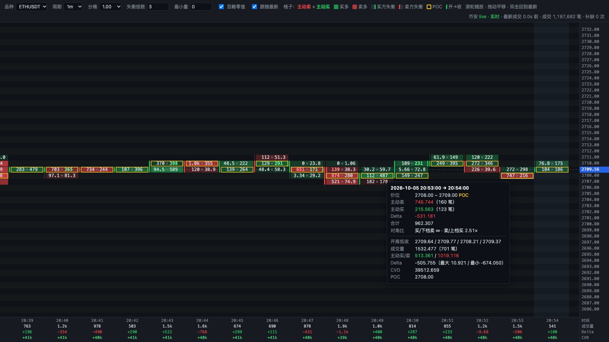

# Footprint 足迹图（币安 U 本位永续）

在本机浏览器里实时显示币安 USDⓈ-M 永续合约每根 K 线、每个价位的主动买量和主动卖量。
只使用币安公开行情接口：不需要 API key，也不包含任何账户或下单代码。

- [使用手册](docs/使用手册.md)：运行步骤、页面说明（含截图）、操作、常见问题
- [架构说明](docs/架构说明.md)：模块分工、数据模型、去重与补缺、推送协议



## 安装

```bash
cd bookmap
python3 -m venv .venv && source .venv/bin/activate   # 可选
pip install -r requirements.txt
```

需要 Python 3.11 以上。依赖只有 `aiohttp`。`aiohttp-socks` 只在使用 SOCKS5 代理时需要。

## 启动

```bash
python footprint.py --symbols ETHUSDT,BTCUSDT --interval 1m --backfill 30 --port 8765
```

启动后终端会打印 `http://127.0.0.1:8765/`，用浏览器打开即可。按 Ctrl+C 退出。

| 参数 | 默认值 | 说明 |
|---|---|---|
| `--symbols` | `ETHUSDT` | 品种，逗号分隔。页面上只能在这些品种之间切换 |
| `--interval` | `1m` | 页面默认周期：`30s` / `1m` / `5m` / `15m`，页面上可以随时切换 |
| `--backfill` | `30` | 启动时回补最近多少分钟的成交。不能超过 `--retention`；币安 REST 只能查最近 48 小时 |
| `--backfill-days` | `0` | 额外加载今天（UTC）之前多少天的历史。这部分从 data.binance.vision 下载每日 aggTrades 压缩包并缓存，今天的部分仍用 REST。启用后会忽略 `--backfill`，保留时长自动延长 |
| `--cache-dir` | `./data/binance-vision` | 历史日包缓存目录。已下载的包不会重复下载 |
| `--retention` | `6` | 内存保留多少小时。切换周期或分桶直接用内存数据，不会重新请求币安。启用 `--backfill-days` 时自动延长到能覆盖全部历史 |
| `--port` | `8765` | 本地端口，只监听 127.0.0.1 |
| `--proxy` | 无 | 代理地址，如 `http://127.0.0.1:7890`、`socks5://127.0.0.1:7891`。不填时依次读取 `HTTPS_PROXY`、`ALL_PROXY` |
| `--save DIR` | 关闭 | 把原始 aggTrade 按 UTC 日期追加保存到 `DIR/<品种>/<品种>-aggTrades-YYYY-MM-DD.csv`，列为 `a,p,q,T,m`。重启后会按最后一个 ID 去重续写 |
| `--log-level` | `INFO` | 日志级别 |

回补 30 分钟大约需要几十个 REST 请求（每个权重 20）。回补期间页面状态栏会显示进度。

### 加载多天历史

```bash
python footprint.py --symbols ETHUSDT,BTCUSDT --backfill-days 3
```

- 今天之前的每一天：下载 `https://data.binance.vision/data/futures/um/daily/aggTrades/<品种>/<品种>-aggTrades-YYYY-MM-DD.zip`，用 `.CHECKSUM` 做 sha256 校验后缓存到本地。解析时兼容带表头和不带表头两种格式。解析在子进程里进行，单个品种一天大约 1 秒。
- 前一天的包通常在 UTC 次日早上（实测约 06:40 UTC）才生成。还没生成时从那天开始改用 REST。比 2 天更早的日子既没有包、REST 也查不到时会跳过，缺失的 ID 数显示在状态栏的「丢失」里。
- **今天（UTC）的部分只能走 REST**，受 1200 权重/分钟的自我限速约束，每分钟最多拉 6 万条（多个品种共享）。在北京时间晚上启动时（UTC 已过去 12 小时左右），ETH + BTC 追平今天大约需要 15 分钟。期间页面会先显示已加载的部分，实时成交在队列里等待，追平后自动接上。
- 内存：已收盘的 30 秒槽会压缩成紧凑整数数组。

## 页面说明

- 每一列是一根 K 线，每一行是一个价位桶。格子里的文字是 **主动卖 × 主动买**（左卖右买）。
- 格子底色按 delta（买 − 卖）着色：买多偏绿，卖多偏红。颜色越深，表示 |delta| 越大（以当前可见范围内的最大值归一化）。
- 失衡（对角比较）：
  - 买方失衡：本档主动买量 ≥ 下一档（更低价位）主动卖量 × 倍数。格子右侧显示绿条，买量变成亮绿加粗。
  - 卖方失衡：本档主动卖量 ≥ 上一档（更高价位）主动买量 × 倍数。格子左侧显示红条，卖量变成亮红加粗。
  - 倍数（默认 3）和最小量（以基础币计）可以在工具栏调整。
  - 「忽略零值」默认勾选：对角档没有成交时不判定失衡，避免价位边缘大量误报。取消勾选后，对角为 0 视为无穷大。
  - 边条越不透明表示比值越大，达到 3 倍阈值时最深。
- 黄框标出 POC（本根成交量最大的价位桶）。列左侧的粗条表示开盘到收盘（绿涨红跌），细线表示最高到最低。
- 每列下方依次显示时间、成交量、Delta、CVD。CVD 从内存里第一根 K 线开始累计。
- 最右边浅蓝底色的一列是尚未收盘的 K 线，大约每 250ms 刷新一次。
- 页面先加载最近 600 根 K 线。向左拖到开头附近时会自动加载更早的 600 根，CVD 始终是从内存中最早数据开始的累计值。悬停时还会显示该格的主动买、主动卖笔数。
- 操作：滚轮缩放（按住 Shift 只缩放横向，按住 Alt 只缩放纵向）；拖动平移，拖动后会自动关闭跟随；双击或勾选「跟随最新」回到最新 K 线；鼠标悬停显示该格和该 K 线的详细数值。
- 数字过大时会缩写（如 1.2k、3.4M）。格子太小放不下文字时只显示颜色。时间按本机时区显示。
- 默认分桶：ETHUSDT 为 1 USDT；其他品种取现价的约 0.03%，再取整到 1、2、5 × 10ⁿ。

## 数据处理说明

- 实时数据来自 `wss://fstream.binance.com/market/stream?streams=<symbol>@aggTrade/...`，是 2026 年拆分后的 /market 入口。
- 启动时先连接 WebSocket 并缓存消息，然后用 `GET /fapi/v1/aggTrades` 回补：第一页按 `startTime` 取，之后用 `fromId` 翻页。最后按聚合成交 ID `a` 和实时流衔接。
- 每个品种只接受 ID 严格递增的成交。发现 ID 跳号（断线、丢包、重连）时，先用 `fromId` 从 REST 补齐，再处理后面的实时消息，所以既不会重复，也不会缺口。断线时间超过保留时长时，改为按时间重新回补。
- 方向判断：`m=true` 表示买方是挂单方，即主动卖出；`m=false` 表示主动买入。
- 价格和数量都换算成整数刻度（tickSize / stepSize）计算，没有浮点误差。内存里保存 30 秒粒度的基础槽，每个 tick 一格。任意周期、任意分桶都由基础槽精确合成，包括 K 线内 delta 的最大值和最小值。
- WebSocket 断线后按指数退避重连（1s 起，最长 60s，带随机抖动）。单条连接满 23.5 小时会主动换线，换线期间的缺口由 REST 补齐。
- 无数据超时：连续 240 秒收不到任何行情消息就主动断开重连。服务端的 ping 不算数据：aiohttp 自带的接收超时会被 ping 重置，所以这里自己计时。
- REST 用 fromId 查 2 天以前的 ID 会返回 `-4166`。补缺时遇到这种情况，改为按时间回补最近 2 天，中间无法找回的部分计入「丢失」。
- REST 限速：读取 `X-MBX-USED-WEIGHT-1M` 响应头，超过 1200 就等到下一分钟。遇到 429 或 418 时按 `Retry-After` 等待，之后最多再试一次，不会反复重试。

## 对账

```bash
# 校验运行中的程序（REST 回补 + WS 实时混合的数据）
python reconcile.py --app http://127.0.0.1:8765 --symbol ETHUSDT --bars 20
# 独立模式：直接用 REST aggTrades 重新聚合最近 N 根已收盘 1m K 线
python reconcile.py --symbol BTCUSDT --bars 10
# 校验某个历史时段（本机时区），例如日包加载的昨天
python reconcile.py --app http://127.0.0.1:8765 --symbol ETHUSDT --start "2026-10-04 09:00" --bars 30
```

脚本会把总成交量和 klines 的 `volume` 比较，把主动买量和 `taker buy base asset volume` 比较。

已知的微小差异：一条 aggTrade 由同一吃单的多笔原始成交合并而成，但只带一个时间戳 T（第一笔的时间）。如果这些原始成交恰好跨过分钟边界，klines 会把它拆到相邻两根，足迹图则整条归入 T 所在的那根。表现为相邻两根一多一少、合计相等。

## 单元测试

```bash
python -m unittest discover -s tests -t . -v
```

覆盖：买卖方向（m 标志）、整数刻度换算、价格分桶、默认分桶、K 线边界、delta / POC / 极值 / CVD、分桶切换一致性、去重、回补与实时衔接、缺口补齐、REST 也查不到的缺口统计、代理环境变量、CSV 续写；槽的冻结/解冻与跨进程传输、按天拼接、CVD 起点与分页；日包解析（有/无表头）；历史流程（日包齐全、昨天未生成、完全没有日包、早期日子缺失、超出 2 天）；无数据超时（服务端只发 ping 时也会重连）。

## 连不上币安时如何检查代理

1. 先确认终端能直连或经代理访问 REST：
   ```bash
   curl -s -m 10 https://fapi.binance.com/fapi/v1/ping                         # 直连，正常返回 {}
   curl -s -m 10 -x http://127.0.0.1:7890 https://fapi.binance.com/fapi/v1/ping
   curl -s -m 10 --socks5-hostname 127.0.0.1:7891 https://fapi.binance.com/fapi/v1/ping
   ```
2. 检查环境变量：`env | grep -i proxy`。程序读取的是 `HTTPS_PROXY` / `https_proxy`，其次是 `ALL_PROXY` / `all_proxy`。`--proxy` 的优先级最高。
3. Clash、Surge 等工具通常同时提供 HTTP 端口（如 7890）和 SOCKS5 端口（如 7891），端口号以客户端设置为准。HTTP 代理要写 `http://`，不要写 `https://`。
4. 使用 SOCKS5 时需要 `pip install aiohttp-socks`。`socks5://` 和 `socks5h://` 都会由代理端解析域名，可以避开本地 DNS 污染。
5. REST 能通但 WebSocket 不通时，检查代理规则是否放行了 `fstream.binance.com`。也可以看启动日志：出现「行情流已连接」表示 WebSocket 正常，出现反复的「行情流断开」时日志里会带具体错误。
6. 启动时报「无法访问币安 REST」时，说明 exchangeInfo 请求失败，基本是网络或代理问题。如果 REST 返回 451/403，说明所在地区受限，需要换代理节点。

## 文件

- `footprint.py`：主程序，包括命令行参数、本地网页 / WebSocket 推送和 CSV 保存
- `fp_binance.py`：币安 REST（限速）、行情流（重连）、按 ID 去重与补缺
- `fp_core.py`：纯计算，包括整数刻度、分桶、30s 基础槽（含冻结压缩）和 K 线合成
- `fp_history.py`：data.binance.vision 日包的下载、校验、缓存和解析
- `static/index.html`：前端，单文件，原生 JS + canvas，不依赖任何外部库
- `reconcile.py`：对账脚本
- `tests/`：单元测试

## 设计参考

数据结构和流程参考了 [Flowsurface](https://github.com/flowsurface-rs/flowsurface)（v0.8.9，GPLv3）的设计思路，代码为独立实现。主要差异：

- 用聚合成交 ID 去重、翻页和补缺口（Flowsurface 按时间处理）。
- 价格分桶向下取整（Flowsurface 足迹取最近倍数）。
- 切换分桶用 30 秒基础槽重新合成，不保留原始成交。
- POC 并列时取价格较低者，结果确定。
