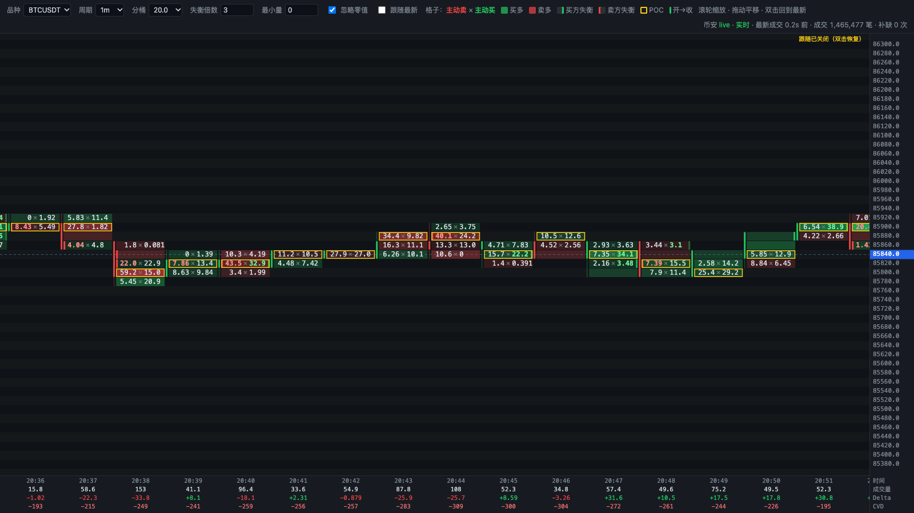

# 足迹图使用手册

本工具在本机运行，用浏览器查看币安 U 本位永续合约的成交足迹：每根 K 线、每个价位的主动买量和主动卖量。只使用币安公开行情，不需要 API key，也没有任何下单功能。


## 一、运行步骤

### 1. 安装（只需一次）

```bash
cd bookmap
python3 -m venv .venv && source .venv/bin/activate   # 可选
pip install -r requirements.txt
```

需要 Python 3.11 以上。

### 2. 启动服务

```bash
python footprint.py --symbols ETHUSDT,BTCUSDT
```

启动成功后，终端会打印：

```
  足迹图已启动：http://127.0.0.1:8765/
```

### 3. 打开页面

在浏览器里访问终端打印的地址，默认是 **http://127.0.0.1:8765/**。

> 页面文件是 `static/index.html`，但**不能直接双击打开**。双击打开时地址栏是 `file://`，页面连不上本地服务，只会显示「本地服务断开，重连中…」。必须先运行 `footprint.py`，再通过 `http://127.0.0.1:端口/` 访问。

### 4. 退出

在终端按 Ctrl+C。

## 二、常用启动方式

| 场景 | 命令 |
|---|---|
| 默认（回补 30 分钟，1m） | `python footprint.py --symbols ETHUSDT,BTCUSDT` |
| 回补更长时间（分钟） | `python footprint.py --symbols ETHUSDT --backfill 120` |
| 加载多天历史 | `python footprint.py --symbols ETHUSDT,BTCUSDT --backfill-days 2` |
| 默认用 5 分钟周期 | `python footprint.py --symbols ETHUSDT --interval 5m` |
| 换端口 | `python footprint.py --symbols ETHUSDT --port 9000` |
| 走 HTTP 代理 | `python footprint.py --symbols ETHUSDT --proxy http://127.0.0.1:7890` |
| 走 SOCKS5 代理 | `python footprint.py --symbols ETHUSDT --proxy socks5://127.0.0.1:7891` |
| 保存原始成交为 CSV | `python footprint.py --symbols ETHUSDT --save ./data/trades` |

全部参数：

| 参数 | 默认值 | 说明 |
|---|---|---|
| `--symbols` | `ETHUSDT` | 品种，逗号分隔。页面上只能在这些品种之间切换 |
| `--interval` | `1m` | 页面默认周期：`30s` / `1m` / `5m` / `15m` |
| `--backfill` | `30` | 启动时回补最近多少分钟 |
| `--backfill-days` | `0` | 额外加载今天（UTC）之前多少天的历史 |
| `--cache-dir` | `./data/binance-vision` | 历史日包缓存目录 |
| `--retention` | `6` | 内存保留小时数；启用 `--backfill-days` 时自动延长 |
| `--port` | `8765` | 本地端口，只监听 127.0.0.1 |
| `--proxy` | 无 | 代理地址；不填时读取 `HTTPS_PROXY`、`ALL_PROXY` |
| `--save DIR` | 关闭 | 把原始 aggTrade 按天追加保存为 CSV |
| `--log-level` | `INFO` | 日志级别 |

### 加载多天历史要等多久

- 今天之前的部分从 data.binance.vision 下载日包，每个品种每天 1～3 秒。已下载的包会缓存，下次启动不再下载。
- 今天（UTC，即北京时间早上 8 点以后）的部分只能通过 REST 拉取。受限速约束，每分钟最多约 6 万条，多个品种共享这个额度。北京时间晚上启动时，ETH + BTC 大约要 15～20 分钟才能追平。
- 追平之前页面已经可以看，只是最新的 K 线要等追平后才会出现。右上角状态栏会显示「加载历史日包」「回补中 xx%」，变成「实时」就表示追平了。

## 三、看懂页面



### 工具栏（页面顶部）

| 控件 | 作用 |
|---|---|
| 品种 | 在启动时 `--symbols` 指定的品种之间切换 |
| 周期 | 30s / 1m / 5m / 15m，切换时不重新请求币安 |
| 分桶 | 每一行代表的价格区间。ETHUSDT 默认 1 USDT，其他品种默认约为现价的 0.03% |
| 失衡倍数 | 判断失衡的倍数，默认 3 |
| 最小量 | 成交量低于这个值的格子不参与失衡判断（以基础币计，如 ETH、BTC） |
| 忽略零值 | 默认勾选。对角那一档没有成交时不判定失衡，避免价位边缘大量误报 |
| 跟随最新 | 勾选时自动停在最新 K 线；拖动后会自动取消，双击画面可恢复 |

工具栏右侧是图例，最右是**状态栏**，显示币安连接状态、回补进度、最新成交延迟、累计成交笔数、补缺次数，以及丢失条数（如果有的话）。

### 主图

- **列**：每一列是一根 K 线，时间按本机时区显示在列下方。
- **行**：每一行是一个价位桶，右侧是价格轴。蓝色标签是最新价，蓝色虚线是最新价所在行。
- **格子文字**：`主动卖 × 主动买`，左边是卖、右边是买。数字大时会缩写，如 `1.2k`；格子太小放不下文字时只显示颜色。
- **格子底色**：按 delta（买 − 卖）着色，买多偏绿，卖多偏红。颜色越深，|delta| 越大（以当前屏幕上的最大值为基准）。
- **失衡**（对角比较）：
  - 买方失衡：本档主动买 ≥ 下一档（更低价）主动卖 × 倍数。格子**右侧有绿条**，买量变成亮绿加粗。
  - 卖方失衡：本档主动卖 ≥ 上一档（更高价）主动买 × 倍数。格子**左侧有红条**，卖量变成亮红加粗。
  - 边条越不透明，表示比值越大。
- **POC**：黄色方框，是这根 K 线里成交量最大的价位。
- **开收细条**：列最左侧的粗条表示开盘到收盘（绿涨红跌），细线表示最高到最低。
- **未收盘 K 线**：最右边浅蓝底色的一列，大约每 0.25 秒刷新一次。

### 底部汇总

每列下方有四行：时间、成交量、Delta（本根买减卖）、CVD（累计 Delta，从内存中最早的数据开始累计）。

### 鼠标悬停

鼠标停在格子上会弹出详情：

- 这一格：价位区间、主动卖/主动买的数量和笔数、Delta、合计、对角比，以及是否失衡、是否 POC。
- 这根 K 线：开高低收、成交量和笔数、主动买/卖、Delta 及其最大最小值、CVD、POC。

## 四、操作

| 操作 | 效果 |
|---|---|
| 滚轮 | 横向、纵向一起缩放 |
| Shift + 滚轮 | 只缩放横向（K 线宽度） |
| Alt + 滚轮 | 只缩放纵向（行高） |
| 拖动 | 平移；会自动关闭「跟随最新」 |
| 往左拖到开头附近 | 自动加载更早的 600 根 K 线 |
| 双击 | 回到最新 K 线并恢复跟随 |

页面会记住上次选择的品种、周期、分桶、失衡倍数和最小量。

## 五、常见问题

**打开页面是空白，或者显示「本地服务断开」**

确认 `footprint.py` 正在运行，并且访问的是终端打印的地址。不要直接双击打开 `static/index.html`。

**页面显示「等待数据…」**

数据还在回补，看右上角状态栏的进度。

**启动时报「无法访问币安 REST」**

网络或代理的问题，按下面的步骤检查：

```bash
curl -s -m 10 https://fapi.binance.com/fapi/v1/ping                           # 直连，正常返回 {}
curl -s -m 10 -x http://127.0.0.1:7890 https://fapi.binance.com/fapi/v1/ping   # 经 HTTP 代理
curl -s -m 10 --socks5-hostname 127.0.0.1:7891 https://fapi.binance.com/fapi/v1/ping
env | grep -i proxy
```

使用 SOCKS5 代理时需要安装 `aiohttp-socks`（已包含在 requirements.txt 里）。

**状态栏出现「丢失 N」**

有 N 个聚合成交 ID 在币安那边已经查不到，常见于断线超过 2 天，或者更早的日子没有日包。其余数据不受影响。

**和币安 K 线比，偶尔有一根多一点、相邻一根少一点**

正常现象。一条聚合成交只带一个时间戳，如果它包含的原始成交跨过了分钟边界，币安 K 线会拆到两根，这里则整条算进第一根。相邻两根合计是一致的。可以用对账脚本自行验证：

```bash
python reconcile.py --app http://127.0.0.1:8765 --symbol ETHUSDT --bars 20
```
