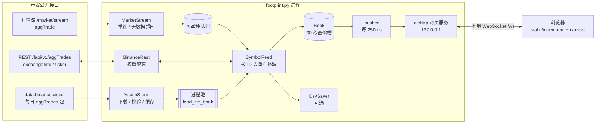
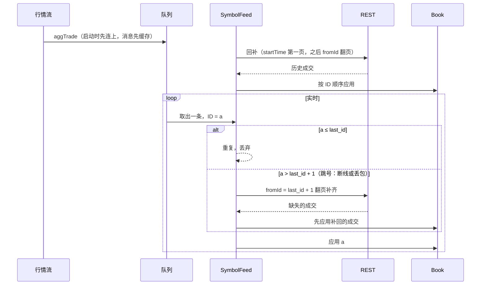

# 足迹图架构说明

## 总览

一个 asyncio 进程完成全部工作：连接币安、聚合成交、提供本地网页，并通过本地 WebSocket 把更新推给页面。启用 `--backfill-days` 时，额外用一个进程池解析历史日包。

## 模块分工

| 文件 | 职责 |
|---|---|
| `fp_core.py` | 纯计算，不做 IO：整数刻度换算、价格分桶、30 秒基础槽 `Slot`、聚合簿 `Book`、K 线合成 `build_bars` |
| `fp_binance.py` | 访问币安：代理、REST 限速 `BinanceRest`、单品种成交序列化 `SymbolFeed`、行情流 `MarketStream` |
| `fp_history.py` | data.binance.vision 日包：下载、sha256 校验、缓存、解析（兼容表头），以及在子进程里聚合成 `Book` |
| `footprint.py` | 命令行、启动流程、本地网页和 WebSocket 推送、快照与分页、定时裁剪/压缩、CSV 保存 |
| `static/index.html` | 前端：单文件、原生 JS + canvas，不依赖任何外部库 |
| `reconcile.py` | 对账：把聚合出的 1m K 线与 `/fapi/v1/klines` 比较 |

## 数据模型

### 整数刻度

价格和数量都按 `exchangeInfo` 的 tickSize / stepSize 精确换算成整数，之后全程整数运算，不会有浮点误差：

- 价格 → tick：`"2714.32"`，tickSize `0.01` → `271432`
- 数量 → 单位：`"3.500"`，stepSize `0.001` → `3500`
- 分桶：`tick // bucket_ticks * bucket_ticks`，即向下取整到分桶的整数倍

同一个价格字符串会反复出现，所以换算结果做了缓存。

### 30 秒基础槽（Slot）

内存里不保存原始成交，而是按「成交时间 T // 30 秒」分槽。每个槽保存：

- 开高低收（tick）、主动买量、主动卖量、笔数
- 槽内从 0 开始的累计 delta（`cum`），以及它的最大值和最小值
- 每个 tick 一格：主动买、主动卖、买笔数、卖笔数

任意周期（30 秒的整数倍）和任意分桶（tick 的整数倍）都可以由槽精确合成。所以切换周期或分桶时，不需要重新向币安请求数据。

K 线内 delta 的最大/最小值也能精确合成：依次遍历这根 K 线包含的槽，维护前缀和 `prefix`，K 线最大值 = max(prefix + 槽.dmax)，最小值同理。

### 冻结压缩

已收盘的槽（两分钟以前的，以及历史日包里的全部槽）会被「冻结」：把逐格的字典压成一个 `array('q')`，每格 5 个整数。这样内存约降到原来的 1/4，也方便跨进程传输。冻结的槽如果又收到成交（比如补缺），会自动解冻。

实测 ETH + BTC 共约 270 万条成交，主进程占用约 100MB。

## 成交序列化：按聚合成交 ID 去重与补缺

`SymbolFeed` 保证喂给 `Book` 的成交 ID 严格递增、连续、无重复。`Book.apply` 本身也会丢弃 ID 不大于 `last_id` 的成交。

### 启动回补

- **默认**：先连行情流（消息进队列缓存），再从 `now - N 分钟` 用 `startTime` 取第一页，之后用 `fromId` 翻页直到追上最新。最后按 ID 与队列里的实时消息衔接。
- **`--backfill-days N`**：
  1. 从最早那天开始，逐天下载日包，在子进程里聚合成 `Book`，再用 `merge_newer` 接到末尾。拼接时检查首尾 ID 是否相接，不相接的差额计入「丢失」。
  2. 某天的包还没生成（前一天的包约在 UTC 06:40 生成），且这一天仍在 REST 可查范围内时，停止加载日包。
  3. 从最后一个 ID 起用 `fromId` 翻页，追平今天。
  4. 比 2 天更早的日子如果没有日包，REST 也查不到，就跳过并计入「丢失」。

### 补缺的边界

- REST 用 `fromId` 查 2 天以前的 ID 会返回 `-4166`。这时改为按时间回补最近 2 天，中间无法找回的部分计入「丢失」。
- 一页之内如果 ID 跳号，同样计入「丢失」。

## 行情流（MarketStream）

- 地址：`wss://fstream.binance.com/market/stream?streams=<sym>@aggTrade/...`，即 2026 年拆分后的 /market 入口。
- **断线重连**：指数退避，1 秒起每次翻倍，最长 60 秒，带 ±20% 随机抖动。连接稳定运行 60 秒后退避时间复位。
- **无数据超时**：连续 240 秒收不到行情消息就主动断开重连。服务端的 ping 不算数据。aiohttp 自带的接收超时会被 ping 重置，所以这里用 `asyncio.wait_for` 自己卡住整体截止时间。
- **24 小时上限**：单连接满 23.5 小时主动换线，换线期间的缺口由 REST 补齐。
- **心跳**：aiohttp 每 30 秒发一次 ping，及早发现死连接。

## REST 限速（BinanceRest）

- 所有请求串行执行，这样权重统计才准确。
- 读取响应头 `X-MBX-USED-WEIGHT-1M`。下一次请求会让权重超过 1200 时，等到下一分钟再发。
- 遇到 429 或 418，按 `Retry-After` 等待，之后最多再试一次，不会反复重试。
- aggTrades 每个请求权重 20、每页最多 1000 条，所以每分钟最多约 6 万条。这是追平今天数据的瓶颈。

## 页面推送协议（本地 WebSocket `/ws`）

| 方向 | 消息 | 说明 |
|---|---|---|
| 服务 → 页面 | `meta` | 品种列表、周期、各品种精度、默认分桶、可选分桶、保留时长 |
| 服务 → 页面 | `status` | 每秒一次：连接状态、回补进度、延迟、笔数、补缺/丢失、无数据重连次数 |
| 页面 → 服务 | `subscribe` | 选择品种、周期、分桶 |
| 服务 → 页面 | `snapshot` | 最近 600 根 K 线（带绝对 CVD），`more` 表示是否还有更早的数据 |
| 页面 → 服务 | `history` | 向左拖到开头附近时，请求 `before` 之前的 600 根 |
| 服务 → 页面 | `history` | 更早的 600 根 |
| 服务 → 页面 | `bars` | 每 250ms 推送一次有变动的 K 线 |

推送规则：

- 只推送有成交变动的 K 线。合成时按 K 线 ID 直接查槽，不扫描全部数据。
- 变动落在页面已加载范围之前（会改变 CVD 起点），或一次变动超过 300 根（比如刚加载完一天日包）时，改发一份完整快照。快照最多每秒一次。
- 每根 K 线的格子格式是 `[分桶下沿 tick, 主动买, 主动卖, 买笔数, 卖笔数]`，价格从高到低排列。数量都是整数单位，页面再按精度换算显示。

## 前端绘制

- 单个 canvas，只绘制可见范围内的列和行。数据变动或交互时，用 `requestAnimationFrame` 合并重绘。
- 颜色深浅按当前屏幕上最大的 |delta| 归一化，再取平方根，让弱信号也看得出来。
- 失衡用对角比较：本档买对下一档卖、本档卖对上一档买。边条的透明度随比值变化。
- CVD = 服务端给出的起点 + 逐根累加。加载更早的数据或按保留时长裁剪时，起点同步更新。
- 实测：200 根 × 60 个价位全部可见时，每帧约 6ms。

## 定时任务

| 任务 | 周期 | 内容 |
|---|---|---|
| pusher | 250ms | 推送变动的 K 线、按需重发快照；每秒推送一次状态、刷新 CSV |
| trimmer | 30s | 裁掉超过保留时长的槽，冻结两分钟以前的槽 |

## 测试与验证

- 单元测试（`python -m unittest discover -s tests -t . -v`）：31 个用例，覆盖方向判断、分桶、K 线边界、delta/POC/CVD、冻结与拼接、日包解析、去重补缺、历史流程各分支、无数据超时、代理、CSV 续写。
- 对账（`reconcile.py`）：与币安 1m K 线比较成交量和主动买量。实测 2 天日包、UTC 零点交接、今天 REST + 实时，大窗口合计全部一致。

## 设计参考

数据结构和处理流程参考了 [Flowsurface](https://github.com/flowsurface-rs/flowsurface)（v0.8.9，GPLv3）的设计思路，代码为独立实现。主要差异见 README「设计参考」一节。
